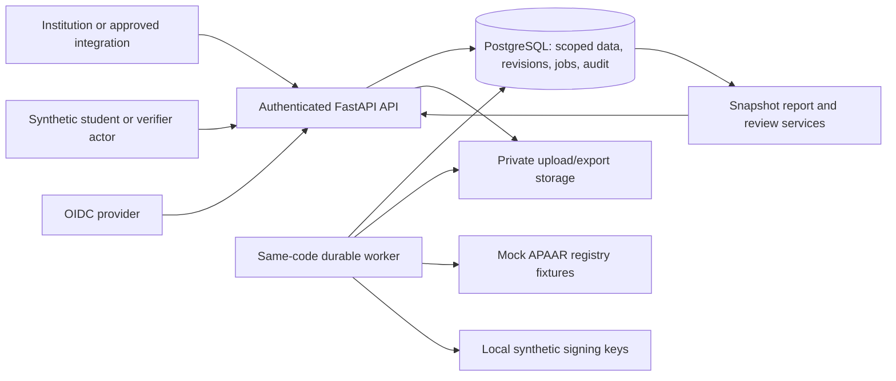

# APAAR-based enrolment assurance platform

Research, product specification and implementation blueprint — 28 October 2026

**Current state:** research and planning only. No application code, deployed service, official integration, reproduced benchmark or passing product tests exist in this workspace. The user explicitly chose research and project files before implementation. All design choices below are proposals for implementation; performance numbers labelled targets are not measurements.

This is the single master specification. Architecture, technology, domain rules, security, workflows, evaluation, operations and the mentor explanation stay in this file. Read [AGENTS.md](AGENTS.md) for working instructions, [CONTEXT.md](CONTEXT.md) for durable decisions, [PHASES_AND_TASKS.md](PHASES_AND_TASKS.md) for execution, and [HANDOVER.md](HANDOVER.md) for the current frontier. Research evidence lives in [research/](research/).

## Executive Summary

Build a backend-first platform that helps an institution submit student enrolment data, understand validation findings, correct mistakes and certify a reproducible admission snapshot. A regulator can examine intake reconciliation and restricted overlap cases; an authorized verifier can obtain a purpose-limited signed enrolment statement. The product's proposed contribution is the quality and traceability of these decisions. APAAR supplies academic identity linkage, while NAD already documents academic award issuance and consent-based verification, so rebuilding a national identity service or certificate locker would create substantial overlap. [1](https://apaar.education.gov.in/faqs) [2](https://nad.digilocker.gov.in/about)

The supplied Claude conversation is a useful requirements baseline, but its linked code archive and detailed report are unavailable here. Claims of 32 rules, 37 tests, perfect synthetic accuracy and roughly 21,000 rows per second have not been reproduced. This specification retains the ten supplied requirements and replaces those implementation claims with explicit acceptance criteria.

Three corrections govern the design. Identifier syntax does not prove registry membership. A second enrolment is a review signal because UGC permits specified simultaneous programmes, subject to relevant restrictions. Capacity evaluation must distinguish admission pools, cohort, programme, approval and policy versions; the older handbook alone cannot establish every current permission. [1](https://apaar.education.gov.in/faqs) [6](https://www.ugc.gov.in/pdfnews/6493421_UGC-Guidelines-pursuing-two-academic-programmes-simultaneously.pdf) [7](https://www.aicte.gov.in/sites/default/files/APH%20Final.pdf)

Use a Python modular monolith, FastAPI, PostgreSQL and one durable worker. Start with synthetic data and a mock registry, deterministic explainable rules, tenant isolation, revision history and a correction workflow. Add scoped verification, signed records, reports and a deployed backend before visual UI work. Policy ambiguity must remain visible rather than becoming an invented cap or silent approval. The separate task plan makes each capability testable and defines when context, tasks and handover must be updated.

## Introduction: scope, provenance and success

### What was actually supplied

The two originals are a Markdown conversation export dated 28 October 2026 and a ten-page PDF of the same exchange. Both were read. The embedded screenshot was decoded and visually inspected: it shows problem statement **26263**, AICTE, Regulation Bureau, Software, Smart Automation. The full ten-requirement text occurs in the user's message at 26 October 2026 13:58:50. Its official online publication was not independently recovered during this research. Treat the supplied text as the requirements baseline, rather than inventing an official website citation.

The original v1/v2 documents, `apaar-core.zip`, detailed Claude artifact report, playbook and presentation were not supplied as local files. Attempts to open the linked research report and playbook did not expose their contents. Consequently, the baseline is the conversation and screenshot, not a recovered source repository. [Extracted conversation](research/baseline_conversation_text.md) and [PDF extraction](research/baseline_pdf_text.txt) preserve what was actually available; the originals remain unchanged.

The previous work correctly redirected the project toward student-level admissions, recognized the need for privacy and revision history, and adopted mock identity verification. Those choices remain useful. The weakness was treating unverified rule values and unseen implementation results as a foundation for the next milestone. This specification starts the implementation ledger from zero and separates regulatory evidence, design decisions and measured software behavior.

### Product intent and boundaries

The intended users are an institution data preparer, a separate institutional certifier, a regulator analyst, an authorized degree-awarding-body issuer, a student or representative in a permission workflow, and an approved external verifier. One developer may simulate these as distinct test actors; that does not mean one person supplies operational separation of duties in a real institution. The platform records reported admissions and their quality. It does not allocate admission offers, take fees, cancel students, make legal findings or authorize an institution to exceed its approval.

The first usable outcome is an API and command-driven synthetic demonstration: import a bounded file, identify errors, submit a corrected revision, certify a pinned snapshot, expose a reconciled report and issue a narrowly scoped verifiable statement. Visual design is deferred until the backend is deployed and its contracts are stable. Reporting data and dashboard APIs are still required before that milestone; deferring appearance does not remove requirement 4.

Use no actual student records, Aadhaar numbers, scanned identity documents, real issuer credentials or production government endpoints in development. Synthetic twelve-digit strings are demo identifiers, not a claimed reserved APAAR range. Block external registry calls and attach `synthetic=true`, a dataset version and a mock-provider label to all fixtures and exported demo records. This avoids suggesting that a plausible-looking number was issued by the national registry.

### Observable success

Success means a new developer can execute the phase plan without guessing the trust model or claiming unfinished work. Product success, once implemented, means ten supplied requirements have observable behavior and evidence: isolated tenants; reproducible validation; correct scoped counting; accountable correction; limited disclosure; signed bytes with issuer/status checks; and recoverable operations. It does not mean winning a competition, universal regulatory compliance, national identity coverage or an unmeasured speed improvement.

### Requirements traceability

| ID | Supplied requirement | Designed capability | Implementation evidence required |
|---|---|---|---|
| R1 | Secure student upload/update keyed by APAAR | Authorized CSV/JSON staging; revisioned identity links and enrolments | Cross-tenant denial, idempotent retry and correction tests |
| R2 | Intake, enrolment, supernumerary, NRI, OCI, FN and relevant fields | Versioned approval/seat pools plus separate student attributes | Round-trip schema and reconciled count examples |
| R3 | Duplicate, missing/invalid ID, excess intake, inconsistency and overlap detection | Deterministic rule findings and restricted review cases | Independent challenge set, boundary and concurrency tests |
| R4 | Institution/regulator monitoring dashboards | Authorized aggregate/report APIs with snapshot and freshness metadata | Reconciliation and leakage tests; visual client later |
| R5 | Secure stakeholder verification | Authenticated, purpose-scoped disclosure request and decision | Denied, expired, withdrawn and wrong-audience requests |
| R6 | Verifiable student records | Signed synthetic enrolment attestation, version and status | Tamper, issuer, key, expiry and supersession checks |
| R7 | Integration APIs | OpenAPI, versioned imports/exports; delivery outbox when needed | Consumer contract and replay tests |
| R8 | Security, privacy, auth, RBAC, audit and consent | Trust-boundary controls described below | Negative authorization, audit and permission lifecycle tests |
| R9 | Policy/accreditation/regulatory reports | Reproducible report snapshots and controlled exports | Same snapshot yields same totals; privacy-safe aggregates |
| R10 | APAAR plus student ID on certificates | Issuer-authorized certificate data/stamp contract and synthetic sample | Both identifiers, issuer authority and access-controlled QR flow |

## Main Analysis

### Finding 1: identity, enrolment and verification are different objects

APAAR documents a lifelong twelve-digit academic identifier. That supports linking episodes to an identity; it does not establish a universally applicable registry checksum, authorize a lookup, prove possession by a particular person or prove enrolment today. Keep format checking, provider assertions, institutional claims and permission decisions separate. A twelve-digit regular expression can validate the input shape and nothing more. Do not invent a Luhn check or describe a mock match as national verification. [1](https://apaar.education.gov.in/faqs)

The internal model therefore uses a random student identity key, a separately protected APAAR link, and many dated enrolment episodes. The official UGC modified guidelines permit specified combinations of simultaneous study and retain conditions involving schedules, recognized providers and relevant council rules. They do not settle every AICTE programme combination. An overlap requires policy-aware investigation; a global uniqueness constraint on active APAAR enrolments would encode an unsupported prohibition. [6](https://www.ugc.gov.in/pdfnews/6493421_UGC-Guidelines-pursuing-two-academic-programmes-simultaneously.pdf)

A provider result has explicit provenance: `MOCK_MATCH`, `MOCK_NOT_FOUND`, `MOCK_MISMATCH`, `MOCK_UNAVAILABLE` or `NOT_CHECKED`, plus fixture version and check time. These are project-defined outcomes, not official API response codes. Preserve separate syntax and verification statuses. A provider outage produces unavailable evidence, not an invalid student. An absent identifier creates a repairable exception with a provisional internal key; it must not cause silent row deletion or the invention of an APAAR.

The adapter boundary accepts only the minimum normalized attributes needed by the mock and returns structured evidence. It has no hidden live fallback. A future live adapter would need documented authorization, purpose, contract, matching semantics, quotas, error handling and data-processing responsibilities. API Setu's documented subscription flow requires publisher approval. A public ABC catalog entry is a discovery lead; this project has neither tested its endpoint contract nor obtained credentials. [4](https://docs.apisetu.gov.in/document-central/explore-apisetu/Overview.html) [5](https://directory.apisetu.gov.in/api-collection/abc)

Missing APAAR eligibility for particular international students remains an open operational question. Model the absence reason and review outcome without asserting that every foreign applicant can obtain the identifier. A production policy owner must decide what can be submitted or certified with unresolved identity evidence. For the synthetic demonstration, unresolved identity prevents an identity-verified attestation while retaining the reported enrolment and its findings. Identity quality and evidence availability are visible dimensions of the result.

The resulting design is deliberately narrow: institutions report dated facts, the mock supplies labelled assertions, and the platform evaluates and explains the relationship between them. No service can grant access merely because the caller knows the printed identifier. These boundaries remain necessary even after a real provider is introduced, since identity membership, academic status and disclosure authority are still different questions.

### Finding 2: capacity is a versioned allocation problem

The base AICTE handbook defines approved intake separately from supernumerary seats and places its NRI provision within approved intake. Those distinctions are enough to reject the naive rule that all enrolment rows must be less than one undifferentiated intake number. They are not enough to certify every current percentage, vacant-seat conversion or institution's permission. The source is the base 2024–27 handbook, and later instruments and specific approval evidence must be reconciled before current enforcement. [7](https://www.aicte.gov.in/sites/default/files/APH%20Final.pdf)

The research located a government-hosted copy of a 2026–27 addendum whose indexed modified clause distinguishes programme/level and appears to restrict the older international-seat vacancy conversion. Direct retrieval of the complete amendment PDF did not succeed. This is a material unresolved conflict, not a verified replacement rule to encode. In particular, Claude's unexplained “case D” must not be reused as an authoritative current exception: its source fixture is absent and its legal premise may have changed. The addendum remains partial evidence pending full retrieval, column-by-column inspection and later-notice checks. [8](https://hte.rajasthan.gov.in/Website/DepartmentOfCollegeEducation/CONTENTFILES/AICTE%20Approval.pdf)

The project therefore separates three authorities. A policy bundle describes an evidenced rule and its applicability. An intake approval describes the institution, offering, year and pools actually sanctioned. An institution submission describes what it reports happened. A submitted `approved_intake` value is a declaration to compare with the approval snapshot; it cannot amend that snapshot. No institution operator may gain capacity by changing a CSV column or choosing a more permissive policy version.

Define the counting scope as institution, campus/offering, programme/course, level, admission cohort/year and any approval-relevant shift or mode. Do not compare all four years of active students to a first-year intake. Store entry route, admission cohort and current study year separately. Lateral entry, carryovers, transfers and readmissions require explicitly sourced counting treatment; they are not miscellaneous extra seats. Where the applicable scope or rounding instruction is unknown, return `APPLICABILITY_UNRESOLVED` and require review.

NRI admission category, OCI status, foreign-national status/citizenship and seat allocation are separate dimensions. Do not assume every OCI or NRI student consumes a supernumerary seat, or that every pair of flags is logically impossible. A policy chooses eligibility and counting rules using explicit evidence. Each counted admission has one allocation to a permitted pool for a particular counting purpose, with a provenance record; the person can still have other status attributes. Avoid adding multiple allowances to the same student.

For a **demo-only** policy, suppose ordinary capacity is 60 and an explicitly sanctioned separate pool is 6. Sixty ordinary admissions plus four eligible admissions assigned to that separate pool yields ordinary utilization 60/60 and separate utilization 4/6. Sixty-one ordinary admissions exceed the ordinary pool even if the separate pool is empty. These are arithmetic examples, not AICTE percentages, approvals or permission to move students between pools. NRI treatment is whatever the selected evidenced bundle says; a label alone never increases the numerator's denominator.

Every rule record needs a stable ID, rule version, source URL and clause/page, source hash when bytes are retained, authority status, effective interval, applicability predicates, required inputs, evaluation function, parameters/units, rounding method, severity, blocking behavior, remediation and reviewed examples. Authority status is one of `demo_only`, `primary_reviewed`, `partial_source` or `unresolved`; severity is a different field. Missing authority cannot become a hard legal verdict merely by setting severity to error.

Use schema-validated YAML for declarative parameters and an allowlist of Python evaluators for logic. No `eval`, arbitrary expressions, dynamically imported rule functions or administrator-supplied SQL. Publishing a new bundle creates a new immutable version and requires source review plus before/after regression cases. Preserve old runs. For this prototype, synthetic approved bundles may exercise capacity mechanics; no default bundle is described as authoritative AY 2026–27 regulation.

### Finding 3: submission, acceptance and correction need separate lifecycles

A reported enrolment can contain an error or reveal a genuine excess admission. The platform must preserve that report so a regulator can inspect it. Rejecting malformed file bytes is different from refusing to certify an otherwise parseable reported excess. Store staged source rows and findings even when certification is blocked. “Accepted for processing,” “institution-certified,” “review-required,” and “accepted by AICTE” are different claims; the prototype implements only its own processing and synthetic institutional certification.

The proposed lifecycle is `DRAFT → VALIDATING → ACTION_REQUIRED or READY_FOR_CERTIFICATION → CERTIFIED`. A technical processing failure enters `PROCESSING_FAILED` with a retryable reason, rather than being treated as a student-data error. A correction forks an immutable candidate revision and links `supersedes_version_id`; it never edits the bytes of a certified version. Rejection of a candidate retains both that candidate and the previously effective snapshot.

Maintain **two current pointers** per scope: latest reported and latest quality-certified. Publish a structurally parseable report to the reported pointer using expected-version checks even when domain findings block quality certification; an unreadable/incomplete file stays a failed candidate. Regulator reports show reported counts/findings alongside certified counts and the gap. A certified 60 followed by a reported 61 must visibly expose 61 and its excess finding while retaining certified 60. Report row count, distinct keyed episodes and unallocatable/ambiguous rows separately; do not silently turn duplicate or unkeyed rows into a reliable headcount. Certification means passing the configured quality gate, not permission to withhold an adverse report.

Use **replacement of a complete declared scope** for the first import contract. The request names its scope and expected current version. Repeated upload of the same file is an idempotent retry when the key and payload agree; a different payload with the same key is a conflict. A replacement is not appended to the old snapshot. Later row-level correction APIs must construct a new complete candidate from a specified base, so there is still one consistent certification path. Delta feeds are a later explicit contract, not a guess based on which rows appear absent.

The canonical disjoint replacement key is `(institution, programme_offering, admission_cohort)`; the offering includes approval-relevant campus/level/mode/shift. Clients cannot invent narrower category scopes. Policy-defined counts may span these keys: lock every affected scope and approval dependency in a deterministic order. An episode move requires explicit linked source/destination revisions committed together; reject a one-sided move that would silently duplicate or omit it. A legitimate approval decrease is recorded, preserves historical certification under its old evidence, and opens current review/revalidation; it does not rewrite history or keep displaying an obsolete green capacity verdict.

Validation produces a run pinned to input bytes, parser/schema version, rule bundle hash, approval versions, registry fixture/results, accepted-reference snapshot, evaluator code revision and evaluation time. Store findings as structured records: row/field, rule ID, observed operands, expected condition, outcome, confidence/evidence status and actionable fix. `PASS`, `FAIL`, `REVIEW_REQUIRED`, `NOT_APPLICABLE` and `UNAVAILABLE` are distinct outcomes. A skipped or unavailable check does not count as passed.

For the demo, `(institution, local_student_id)` is unique and never reused; it maps to a stable internal episode key through replacements. Adding/correcting APAAR changes that episode's reviewed identity link, not its episode identity. Local-ID changes require an explicit old-to-new mapping; never merge people by name. Missing/malformed IDs and mock-not-found/mismatch block quality certification; mock-unavailable/not-checked require review and also block that gate without being labelled invalid. Only format-pass plus `MOCK_MATCH` can proceed, subject to all other gates. Every outcome remains reportable; none establishes official identity. This matrix is a conservative demo policy, not a national admission rule.

Before certification, the checker must be a different authorized subject from the candidate's maker, remain a member of the same institution and have scope-specific authority. Recheck identity, candidate revision, current approval version, bundle policy and outstanding blocking findings. A test operator may log in under two synthetic subjects to demonstrate this; the audit records both subjects honestly. The system does not silently permit self-approval because the project has one developer.

Certification must be atomic. PostgreSQL's default Read Committed behavior and row-lock semantics do not make an ordinary count-then-write sequence safe against competing transactions. The design uses a stable scope row locked during the final recomputation and effective-snapshot change. Every correction, withdrawal, approval change and administrative import affecting that count must follow the same locking protocol; locking the parent alone does not force unrelated code paths to cooperate. [11](https://www.postgresql.org/docs/18/explicit-locking.html) [12](https://www.postgresql.org/docs/18/transaction-iso.html)

Inside the short transaction, acquire affected scope locks in deterministic order, compare expected versions, calculate the candidate effective population, evaluate capacity, insert certification/audit/job records and change the effective pointer together. Do no external provider or signing-service call while holding the lock. Prepare a durable receipt payload in the transaction, then sign it idempotently in the worker. A record is `CERTIFIED_PENDING_RECEIPT` until a signature is available; failure to sign cannot create a false completed receipt. Publish status changes from committed data only.

At Read Committed, lock before recounting in a subsequent SQL statement. After rollback to a savepoint predating context/lock setup, re-establish the required context and locks before continuing. All relevant writers participate in the same protocol; a Serializable alternative requires coordinated transaction boundaries and whole-transaction retries.

For an explicit adversarial test, start two certifications against a nearly full shared counting scope, coordinate their transactions, and show the second reevaluates the first committed result or receives a version conflict. For complete-scope replacements, a stale expected version must lose rather than double-count or overwrite unnoticed. If a later invariant spans scopes and the lock protocol becomes unreliable, use Serializable transactions with bounded whole-transaction retries. This is an implementation choice to reevaluate against actual requirements, not a promise of universal serializability.

Conflict review has its own lifecycle: `OPEN → IN_REVIEW → RESOLVED or DISMISSED`, with reopen history. It records the evidence, policy, reviewer, decision and explanation. Corrections can invalidate earlier decisions, so recertification reruns dependent checks. A dismissed overlap finding does not erase the observation or grant future blanket permission. A regulator can see the participating synthetic cases; an institution receives only the authorized case information, never a browseable national student search.

### Finding 4: isolation must cover objects, fields and processing paths

Authorize every resource operation and every returned or writable field. OWASP identifies object-level authorization and property-level authorization as separate API failure classes. A valid login, random UUID or tenant filter on one endpoint does not protect an export, job status, writable approval field or alternate lookup route. The implementation's permission matrix must cover each of these paths. [18](https://api-security.owasp.org/editions/2023/en/0xa1-broken-object-level-authorization/) [19](https://api-security.owasp.org/editions/2023/en/0xa3-broken-object-property-level-authorization/)

Institution preparers can stage and correct their institution's data; certifiers can approve eligible candidates but cannot certify their own work. Regulator analysts receive only the scopes granted to them, not a universal administrator role. Policy maintainers can propose bundles; they cannot silently change existing evidence. External verifiers receive an approved disclosure view, never direct enrolment-table access. Degree-awarding-body issuers require an explicit relationship to the records they attest. Service identities have narrower machine permissions and cannot impersonate human approval.

Use OIDC authentication through an established provider, with a locally configured test realm during development. Validate token issuer, intended audience, lifetime and configured algorithms, then resolve membership and roles server-side. Tenant IDs, certificate issuer IDs and approval permissions from request bodies are claims to validate, not authority. If JWT is used, bind keys to the configured issuer and constrain algorithms; never follow arbitrary token-supplied key locations. Separate access tokens from signed-record tokens with explicit types and purposes. [21](https://www.rfc-editor.org/rfc/rfc8725.html)

PostgreSQL row-level security is defense against missing filters, with documented exceptions: owners normally bypass it; superusers and `BYPASSRLS` roles retain bypass powers; broad permissive policies can widen access. Use separate migration-owner and runtime credentials, restricted grants and forced RLS where appropriate. Tests must connect as the actual runtime role. RLS is not protection against a compromised backend capable of arbitrary SQL under credentials that can set its own tenant context, nor does it govern files or logs. [9](https://www.postgresql.org/docs/18/ddl-rowsecurity.html)

Open a transaction after authentication, set the authorized institution context with parameterized transaction-local configuration, then execute tenant queries. Reapply context for every transaction, including worker work. Missing context denies tenant access. `SET LOCAL` ends at transaction completion, which is the needed boundary for pooled connections; a persistent session setting risks contaminating a reused connection. Include reuse, rollback, missing-context and worker-retry tests. [10](https://www.postgresql.org/docs/18/sql-set.html)

Tenant-owned child relationships use institution-inclusive foreign keys so a row cannot reference another institution's submission through a globally valid UUID. Use a separate narrow cross-institution matching service/role over a restricted identity index. An ordinary institution role cannot query that index. The regulator's permitted cross-tenant operation is explicit and audited; it is not an accidental RLS bypass shared with ordinary handlers. Keep personal fields out of error details, database constraint messages, metrics labels and trace payloads.

Protect APAAR values with application encryption and a separate keyed HMAC lookup value for exact matching, with independent keys and version identifiers. The HMAC is pseudonymous sensitive data, not anonymous data: an application holding the key can still calculate matches. Mask display by default. Keep searchable attributes to the minimum; use random internal IDs in URLs. Production key custody and rotation need operational verification before any real data. Synthetic local keys must never be reused as deployment secrets.

Upload authorization extends to private storage keys and downloads. Limit file size, rows, columns and field lengths before expensive parsing; accept UTF-8 CSV and typed JSON first. Reject archives, macros and unsupported formats. Normalize delimiters and identifiers explicitly while preserving original bytes/hash and row number. Reject or quarantine unexpected fields. Escape spreadsheet-formula prefixes in CSV exports. Never fetch a URL supplied in a row. These are selected threat controls to prove in the import/export tests, not claims that a framework applies them automatically.

### Finding 5: privacy is a set of purposes and lifecycle obligations

The legal research inspected the Act, the final 2025 Rules, commencement notification, corrigendum and an October 2026 removal-of-difficulties order. Main processing duties and associated rules have staged commencement; they must not all be described as already operative on 28 October 2026. Printed and electronic publication dates introduce a day-level calculation question, so the implementation checkpoint should recheck the official publication trigger before relying on precise November 2026 or May 2027 dates. January 2025 draft notes are not the final Rules. [22](https://www.meity.gov.in/static/uploads/2024/02/Digital-Personal-Data-Protection-Act-2023-1.pdf) [23](https://www.meity.gov.in/static/uploads/2025/11/c56ceae6c383460ca69577428d36828b.pdf) [24](https://www.meity.gov.in/static/uploads/2025/11/53450e6e5dc0bfa85ebd78686cadad39.pdf) [25](https://www.meity.gov.in/static/uploads/2025/12/3c7ebbae0e5456f493f486e6845df86b.pdf) [26](https://www.meity.gov.in/static/uploads/2026/10/daf495a7b5798a3dfa72a944b51fc176.pdf)

The design records processing purpose and assessed ground separately from permission to disclose. The Act provides consent and specified legitimate uses, so neither “all processing is always consent-only” nor “regulators can always read everything” is an acceptable blanket rule. For the mock employer-verification path, choose explicit student-authorized sharing as a conservative product decision. This does not establish the lawful basis of a future real AICTE service or every institutional workflow. [22](https://www.meity.gov.in/static/uploads/2024/02/Digital-Personal-Data-Protection-Act-2023-1.pdf)

A disclosure grant records student/representative, authenticated requester, recipient, purpose, allowed fields, record scope, grant time, expiry, notice version and revocation state. Approval of an admission record is not approval of employer disclosure. A submitted institution checkbox is not proof the student authorized sharing. The synthetic demonstration needs distinct simulated student/guardian actors and an auditable grant event. Before real deployment, establishing the student's control of the relevant identity is a separate prerequisite that the mock does not solve.

Server-controlled fixture data binds each synthetic OIDC subject to its student or guardian authority; institution operators cannot assign that binding. Bind each grant to one immutable certified snapshot, allowed fields, purpose and authenticated recipient subject/organization. Supersession invalidates outstanding grants and requires a new decision. The recipient redeems through `POST /v1/verification-requests/{id}/disclosures`; recheck authorization, grant and record status for each response and artifact download. Private artifacts stay behind that gateway rather than a reusable unchecked URL. Already downloaded copies remain outside revocation control.

For children, include a guardian relationship and a visibly synthetic permission path. The final Rules' educational-institution exception is conditioned and purpose-limited; it is not blanket permission for employer disclosure. Do not infer legal guardianship from a shared surname or institution assertion. The October 2026 order corrects statutory wording and must be considered with the original Act. Production identity/guardian verification and any applicable exception require a fresh institution-specific assessment. [24](https://www.meity.gov.in/static/uploads/2025/11/53450e6e5dc0bfa85ebd78686cadad39.pdf) [26](https://www.meity.gov.in/static/uploads/2026/10/daf495a7b5798a3dfa72a944b51fc176.pdf)

Consent withdrawal ends future consent-based disclosure; it cannot recall a file already downloaded. Separate that access decision from correction, record supersession and erasure. The Act and final Rules include retention conditions, including a staged minimum one-year processing-data/traffic/log provision for specified purposes. Therefore do not promise immediate destruction of every student record or immutable perpetual retention. Define retention classes for uploads, enrolment history, grants, disclosures, security logs and backups, with purpose, duration, hold conditions and deletion procedure. [22](https://www.meity.gov.in/static/uploads/2024/02/Digital-Personal-Data-Protection-Act-2023-1.pdf) [24](https://www.meity.gov.in/static/uploads/2025/11/53450e6e5dc0bfa85ebd78686cadad39.pdf)

CERT-In's directions are a distinct applicability assessment: they specify six-hour reporting for listed incidents by covered entities and securely maintained rolling 180-day ICT logs within India. The final DPDP Rules separately distinguish initial breach communication without delay from detailed Board information within 72 hours, in their relevant commencement tranche. Do not merge those clocks or treat 72 hours as permission to delay every initial report. Hosting, account data and access telemetry also need review even when enrolment fixtures are synthetic. [27](https://www.cert-in.org.in/PDF/CERT-In_Directions_70B_28.04.2022.pdf) [24](https://www.meity.gov.in/static/uploads/2025/11/53450e6e5dc0bfa85ebd78686cadad39.pdf)

Finally, reporting privacy belongs in the shared report service. A small-cell threshold such as five is only a provisional project choice. NIST describes secondary suppression because totals can expose hidden cells. Test totals, complementary categories, overlapping queries and successive snapshots; restrict the initial external report catalogue instead of offering arbitrary demographic drill-down. Authorized regulator reports may need exact small counts, so apply purpose/role policy rather than corrupting underlying data. [30](https://nvlpubs.nist.gov/nistpubs/SpecialPublications/NIST.SP.800-188.pdf)

### Finding 6: verifiable records need issuer, status and disclosure policies

NAD already documents institution-issued academic awards and student-consented verification. This project should complement that ecosystem with an enrolment assurance statement rather than claim to replace it. A university certificate, institution-reported admission and platform validation receipt have different issuers and meanings. The supplied requirement to display APAAR beside the local student ID is retained as a product requirement; this research did not establish a universal statutory printing mandate. [2](https://nad.digilocker.gov.in/about) [3](https://nad.digilocker.gov.in/faq)

The first signed object is an application-specific JSON enrolment attestation, not a claim of W3C VC conformance. It includes schema/type, synthetic issuer, audience/purpose where applicable, random record ID, authorized minimal subject fields, institution/offering, enrolment status and as-of time, snapshot reference, mock verification provenance, issue/expiry time, signing key ID and status reference. Use a maintained cryptography/JWS library with a fixed reviewed algorithm, such as EdDSA with Ed25519 after compatibility checks. Sign defined bytes through a documented library format; do not invent JSON canonicalization or cryptography.

W3C explicitly distinguishes a verifiable credential from truth of its claims. Accordingly, verification returns separate results for structural validity, trusted issuer, signature, time validity, current status, intended purpose/recipient and underlying evidence provenance. Even all-green cryptographic checks mean only that the configured issuer made the statement under the stated policy. They do not prove national identity issuance, actual attendance, government approval or a degree award. [20](https://www.w3.org/TR/2025/REC-vc-data-model-2.0-20250515/)

Define record lifecycle states `ACTIVE`, `SUPERSEDED`, `REVOKED` and, if needed, `SUSPENDED`. A correction supersedes the old attestation; cancelling an enrolment is a source-domain event; revoking a disclosure grant controls new sharing; compromising a key affects trust in signed artifacts. These are distinct transitions. When online status cannot be checked, return `INDETERMINATE` rather than current-valid. Offline verification must disclose that current revocation status was not established.

Routine rotation uses a new signing key while retaining authorized old public keys for historical verification. A compromise requires a documented affected-record policy, disablement, revocation/reissue and cache invalidation. A self-asserted issuance timestamp is insufficient proof a compromised key signed before compromise. Keys must be bound to approved issuers and algorithms; a token-supplied `kid` only selects within a trusted key set. The JWT guidance supports these checks when JWT is the selected format, not a requirement to use JWT everywhere. [21](https://www.rfc-editor.org/rfc/rfc8725.html)

Use an internal status table first. If interoperability later warrants W3C VC and Bitstring Status List, treat that as a new conformance task with the pinned Recommendation, trust governance and privacy tests. The status-list Recommendation describes revocation/suspension and caching considerations; it is not a universal freshness SLA. The prototype may choose a provisional 60-second online freshness target, explicitly as an engineering target. [28](https://www.w3.org/TR/2025/REC-vc-bitstring-status-list-20250515/)

Certificate support begins with an issuer-authorized data endpoint and a synthetic certificate/stamp sample containing both identifiers. A QR encodes only an opaque random reference to an access-controlled verification flow. It contains no bearer authority to view the full student file. Signed plaintext is still readable plaintext, so never hide private fields inside a public JWT or QR. The degree-awarding body's authority and identity link must be checked before an attestation is described as its certificate. Mock issuance remains visibly synthetic on the document and response.

### Finding 7: evaluation must challenge the policy and the implementation separately

The missing Claude engine's synthetic score cannot establish correctness of either its code or its regulatory assumptions. NIST's AI RMF calls for documented test conditions and independent assessment in its evaluation framework. Here the useful inference is to separate the test oracle from detector authorship: a new random seed from the same generator is not an independent policy review. The project can adopt that discipline without introducing an AI model. [29](https://airc.nist.gov/airmf-resources/airmf/5-sec-core/)

Create four suites: hand-worked policy boundary cases, mentor/domain-reviewer challenge cases, stochastic synthetic workloads, and adversarial lifecycle/security sequences. Freeze source-backed expected outcomes before evaluating a release. If a mentor has not reviewed the fixtures, label the result developer-authored rather than independent. Keep ambiguous or unsupported rules in a separate coverage category. Measure per-rule error counts and denominators; avoid combining unknown policy, unavailable provider checks and confirmed failures into a flattering single accuracy number.

Test row-order and batch-size invariance, idempotent replay, exact count reconciliation and supersession. Add dates and legitimate near-misses: transfers with non-overlapping intervals, permitted simultaneous study under a selected demo policy, a registry outage, two submissions racing, stale approval versions and a candidate corrected during review. Test that malformed rows cannot disappear from the received/rejected/processed reconciliation. A passing fixture suite demonstrates those cases, not universal correctness.

Start anomaly detection as advisory prioritization with explicit reasons: sudden utilization changes, unusual proportions with adequate denominators, correction bursts and unresolved overlaps. Version the ranking and expose each reason's contribution. A priority score is not a probability of fraud. Small comparison groups return insufficient evidence. Statistical or ML ranking is justified only if it beats the simple baseline on a frozen challenge set with a stated reviewer budget and false-alert cost; until then, its complexity adds no demonstrated value.

Security evaluation includes more than happy-path role tests. Try another tenant's UUID, a cross-tenant child reference, forged institution fields, an expired grant, a revoked record, an unknown issuer, an unapproved signing algorithm, and private export URLs. Probe whether an overlap warning becomes a membership oracle through bulk guessed submissions. Compare unauthorized known/unknown-record responses and document residual timing differences. Restrict probing by admission workflow, membership, quotas and review access; do not promise perfect absence of inference from a few tests.

Provisional performance targets are a durable 100,000-row synthetic import and validation within five minutes on a named development machine, and ordinary authorized read p95 below 500 ms at 20 concurrent clients under a specified workload. These targets are unmeasured and revisable. Capture database and index sizes, constraints/RLS enabled, code/rules/fixture hashes, seed, hardware, concurrency, errors, memory and end-to-end upload-to-report latency. National-scale capacity remains unproven until workloads and deployment evidence exist.

## Architecture

### Deployment shape and boundaries

Choose one modular monolith and one separately restartable worker from the same source/image. PostgreSQL stores transactional state and durable jobs. Private file/object storage holds bounded original uploads and generated exports; the database stores ownership, hashes and access metadata. A standards-based identity provider supplies authentication. There is no need initially for Kafka, Redis, Kubernetes, microservices, a vector database, blockchain or an LLM decision engine. Reconsider a component when a measured bottleneck or a required capability makes it the simpler complete solution.



Modules are `access`, `institutions`, `approvals`, `identity`, `submissions`, `validation`, `review`, `attestations`, `reporting` and `audit`. A module owns its use cases and table access; avoid generic repository/service/factory layers without a real need. Shared code is limited to actual shared concerns such as transaction/context setup and typed error responses. HTTP handlers authenticate and delegate to use cases; use cases own transactions; parser/rule functions remain testable without HTTP.

The API never runs an unbounded import after sending the response. Starlette describes response background tasks as in-process. Persist a job before returning `202 Accepted`; expose its status, progress watermark and actionable failure reason. PostgreSQL documents `SKIP LOCKED` for queue-like work, making a small job table an available initial choice. This does not automatically provide retries, durability of external effects or exactly-once processing. [14](https://starlette.dev/background/) [13](https://www.postgresql.org/docs/18/sql-select.html)

The worker claims a job in a short transaction, sets an attempt/lease token, processes outside the claim lock and completes only if its token still owns the lease. Recover expired leases after crashes, cap attempts and retain failed-job evidence. Use unique effect keys for repeated processing. Add an outbox only when an external delivery is implemented; insert it with the business transaction and deliver at least once with bounded retries. Never use `SKIP LOCKED` when computing intake populations, since skipping locked admissions would make counts incorrect.

### Data model and ownership

The table names below define the intended model; no migrations exist yet. Use UUID internal keys, timezone-aware timestamps and explicit version fields. Store academic year/cohort as domain values rather than inferring them from upload time. Count effective snapshots rather than every historical row. All tenant-owned relationships include institution ownership; restricted central identity matching is a separate authorization surface.

| Entity | Essential content and constraints |
|---|---|
| Institution / membership | Synthetic institution reference, active status; authenticated subject, role and authorized scope |
| Programme offering / counting scope | Institution, campus, course, level, mode/shift as relevant; stable lock row for cohort/policy scope |
| Intake approval | Source/authority status, effective dates, institution/offering/year, approved pools, version, supersession |
| Student identity / identity link | Random student key; encrypted APAAR, keyed lookup and key versions; provider evidence; restricted access |
| Enrolment episode | Institution local student ID, student link, offering, entry route, cohort, active interval/status; separate NRI/OCI/FN attributes and allocation evidence |
| Submission / version / staged row | Ownership, scope, expected base, immutable bytes/hash, schema/parser version, row number, declared totals, raw-to-normalized errors |
| Rule bundle / validation run / finding | Immutable policy metadata and parameters; all pinned inputs; operands, outcome, remediation and rule/source references |
| Review case / decision | Authorized case scope, evidence references, state, reviewer, explanation, timestamps and reopen/supersession links |
| Reported / certified snapshot | Separate current pointers for canonical scope; report findings even when certification fails; maker/checker, pinned evidence and receipt state |
| Disclosure request / grant / event | Recipient, purpose, allowed fields, subject/guardian evidence, expiry/revocation and actual disclosure audit |
| Attestation / signing key metadata | Issuer/type, snapshot, signature reference, active/superseded/revoked status; public-key metadata, never private key in a row |
| Job / audit event / export | Lease/retry/effect key; accountable state transitions; private artifact ownership, hash, retention and expiry |

A student can have several episodes, and an institution can have many versions of one episode's representation. Apply the demo's institution-local-ID no-reuse rule without making it globally unique across institutions. Foreign keys and row-local CHECK constraints protect structural integrity; aggregate intake consistency belongs in the certification transaction because PostgreSQL CHECK constraints do not implement arbitrary cross-row invariants. [15](https://www.postgresql.org/docs/18/ddl-constraints.html)

Avoid unnecessary personal fields in the first schema. Use synthetic display name only where the demo needs it; include dates of birth or guardian metadata only for an explicit test purpose. Do not ingest Aadhaar, passports, document images or contact lists. “Foreign passport required by a clause” is not authorization for this prototype to collect passport scans. Keep an evidence reference and an unresolved eligibility state instead.

### Technology stack and rationale

These are selected implementation baselines, not a statement of latest package versions. At Phase 1, verify current support and compatibility, lock exact dependencies and record actual tool versions. Change a selection when the narrower working solution calls for it; record the impact in the decision register rather than treating this table as permanent law.

| Layer | Selection | Reason and constraint |
|---|---|---|
| Runtime | Python 3.13 target; `uv` environment and lockfile | One language for API, validation, fixtures and worker; verify library wheels/support before locking |
| HTTP contracts | FastAPI and Pydantic v2 | Typed API/OpenAPI; explicit strict boundary rules and response schemas |
| Persistence | PostgreSQL 18 target, SQLAlchemy 2, psycopg 3 | Real relational transactions, constraints and RLS; sync use cases first |
| Migrations | Alembic | Reviewed migrations include policies, grants and data transitions; generated candidates are not automatically correct |
| Authentication | OIDC; Keycloak local test realm initially | Established protocol and distinct demo actors; production provider/operations choice remains open |
| Imports / rules | Standard-library CSV/JSON, schema-validated YAML, allowlisted evaluators | Bounded predictable formats; no dataframe/ML dependency for ordinary rules |
| Jobs | One Python worker plus PostgreSQL jobs | Durable state and small deployment; revisit when workload evidence warrants a maintained queue system |
| Files / signatures | Private local storage in development; private object storage for deployed artifacts; maintained JWS/crypto library | Ownership checks, bounded downloads, explicit signature format and local synthetic issuer |
| Verification | Internal versioned signed-record/status contract | No claim of W3C or national credential conformance; interoperable profiles later if needed |
| Quality | pytest, focused Hypothesis properties, Ruff and type checking | Regression, concurrency and trust-boundary evidence; no coverage percentage theatre |
| Operations | Docker Compose development; one API and worker deployment, managed PostgreSQL preferred for hosted demo | Portable, recoverable starting shape; exact host and budget chosen before deployment |
| Telemetry | Structured redacted logs, request/job IDs and basic metrics | Observe latency, queue age, failures and audit continuity without logging student identifiers |

Pydantic normally permits some coercion, so treat APAAR and student IDs as strings, preserve leading zeros and make normalization explicit. Strict validation still requires deliberate date/JSON handling and domain checks. Alembic requires manual review of autogenerated candidates; inspect RLS and role grants particularly carefully. These tools reduce repetitive work, not the need to understand data or security semantics. [17](https://pydantic.dev/docs/validation/latest/concepts/strict_mode/) [16](https://alembic.sqlalchemy.org/en/latest/autogenerate.html)

Use a small future repository layout: `src/apaar/` for named modules, `tests/` for unit/integration/contracts, `rules/` for reviewed bundles, `fixtures/` for synthetic profiles, `migrations/`, and `compose.yaml`. Keep this master file and the four continuity files at root. There is no requirement to create empty module files, framework wrappers or all listed tables before the first vertical path needs them.

### API and event contracts

Version endpoints under `/v1`; the following is the proposed contract catalogue. Generate and freeze OpenAPI when implementation exists. Every resource lookup checks action, ownership and allowed fields, including job status and downloads. Do not expose a `GET /students/{apaar}` enumeration endpoint.

| Operation family | Proposed routes | Key behavior |
|---|---|---|
| Reference data | `GET /v1/offerings`, `GET /v1/approvals` | Scoped current/historical approval views; maintainers alone can propose changes |
| Submission | `POST /v1/submissions`, `GET /v1/submissions/{id}` | Stage bounded CSV/JSON; explicit replacement scope; idempotency key; durable job |
| Validation / correction | `POST /v1/submissions/{id}/validation-runs`, `GET /v1/validation-runs/{id}/findings`, `POST /v1/submissions/{id}/revisions` | Pin evidence, paginate errors, create immutable replacement candidates |
| Certification | `POST /v1/submissions/{id}/certifications` | Separate checker, expected version, recomputation, atomic state/audit/job |
| Review | `GET /v1/review-cases`, `POST /v1/review-cases/{id}/decisions` | Scope-specific evidence and accountable resolution; no public overlap search |
| Reports | `GET /v1/reports/intake`, `GET /v1/reports/quality`, `POST /v1/exports` | Snapshot, filters, audience policy, private artifact and freshness watermark |
| Disclosure | `POST /v1/verification-requests`, `POST /v1/verification-requests/{id}/decisions`, `POST /v1/verification-requests/{id}/disclosures`, `POST /v1/grants/{id}/revocations` | Fixture-bound decision actors; immutable snapshot and recipient; redeem/recheck every disclosure/download |
| Signed records | `GET /v1/attestations/{id}`, `POST /v1/attestation-verifications` | Protected retrieval; issuer/signature/time/status/provenance checks returned separately |
| Certificate support | `GET /v1/certificate-records/{id}` | Authorized issuing-body view; both identifiers and opaque QR reference |
| Processing | `GET /v1/jobs/{id}`, health/readiness endpoints | Tenant-safe progress; readiness checks dependencies without exposing secrets |

Asynchronous creation returns a job/resource reference with `202`; validation findings are domain outcomes, not server exceptions. Use `400/422` for malformed contract input, `401` for missing/invalid authentication, `403` or existence-hiding `404` according to a consistent resource policy, `409` for version/idempotency/state conflicts, and `429` for quotas. Return stable error codes, request ID and safe remediation. Avoid revealing whether a foreign tenant's object exists through a different error shape.

Every paginated response has a stable ordering/cursor. Snapshot reports include `snapshot_id`, `as_of`, `generated_at`, rule/approval version references, filters and `data_freshness`. Dashboard data can initially be polled; “real time” means committed updates with a stated freshness target, not instantaneous national registry synchronization. A proposed local target is report freshness within 60 seconds after processing completes. Measure it before advertising it.

Institution adapters use versioned schema mappings and contract fixtures. Add signed outbound webhooks only after a real consumer requirement, with event ID, timestamp, key version, bounded retries and receiver deduplication. Reject stale/replayed inbound requests according to an agreed contract. SFTP, direct ERP connectors and national portal submission are future adapters with named owners and documented access; do not implement speculative connectors just to make an architecture diagram larger.

## Guardrails and engineering rules

Evidence and flexibility must reinforce each other. A change is welcome when it solves a demonstrated requirement, but it must update the affected contract, rule version and acceptance cases. A new feature does not justify rewriting unrelated modules, adding a distributed system or hiding an unresolved domain question. Keep the smallest implementation that completely handles the authorized behavior, including its security and recovery paths.

The non-negotiable boundaries are: synthetic data and mock identity verification only; no Aadhaar collection; no official integration or government-acceptance claims; no identifier-only disclosure; no automatic fraud verdict from overlaps/anomalies; no editable certified history; no silent policy fallback; no capacity inferred solely from student categories; no self-certification; no cross-tenant access through files/jobs/reports; and no test/benchmark claim without a saved actual result. These are project rules. Specific legal permissions still require appropriate evidence before real deployment.

For every work unit, state the requirement, intended observable behavior, affected trust boundaries and focused checks. Read the current implementation and continuity files first. Make the change, inspect its diff, run the relevant checks, and record actual outcomes. A failed check stays visible. Do not invent a test just to match each line of code; choose tests that could expose a plausible failure. Conversely, authorization, concurrency, policy interpretation and disclosure need explicit adversarial cases because ordinary happy-path checks are insufficient.

Use one decision register inside this file, not an architecture document per feature. When evidence changes, mark a decision superseded with a date and a pointer to its replacement; do not rewrite history to imply the new choice was always established. After a coherent milestone, update the phases/tasks file, durable context and compact handover. These are agent-maintained files, not scheduled processes, self-running hooks or authorization to start unrelated work.

| Decision | Current choice | Revisit trigger |
|---|---|---|
| D1 | Modular monolith plus same-code worker | Measured independent scaling/operational need or separately owned services |
| D2 | Synthetic-only/mock registry | Explicit authorization plus reviewed partner access, purpose, contract and security gates |
| D3 | Complete-scope replacement revisions | A real consumer requires delta semantics and their reconciliation cases |
| D4 | Reviewed demo rules until complete policy evidence | Retrieved amendment chain, course/year approval and independent domain sign-off |
| D5 | Advisory explainable anomalies | Frozen evaluation demonstrates useful incremental statistical/ML performance |
| D6 | Application signed enrolment statements | Interoperability requirement justifies a named credential conformance profile |
| D7 | Backend/report APIs before visual design | Deployed synthetic backend, verified contracts and explicit UI work request |
| D8 | No existing engine assumed | Original archive supplied, audited, reproduced and assessed for reuse |

## Operations, deployment and recovery

Deploy only the synthetic service initially. Select a host, region, budget and operator before provisioning anything. Prefer a simple API/worker deployment with private database networking and managed backups if the chosen budget permits. An India-region choice can help prepare for applicable operational requirements but is not, by itself, proof of legal compliance. Hosting data and OIDC accounts may still contain real operational metadata even with fictional student records.

The CI sequence is dependency installation from lockfile, formatting/lint/type checks, focused unit and property tests, real-PostgreSQL integration tests under runtime credentials, contract snapshot checks and a container build. Security-critical changes also run the relevant permission/concurrency/lifecycle suites. Scan dependencies and protect secrets before a release. Do not run database migrations from every API replica at startup; use one controlled migration step, inspect destructive changes and have a recovery plan.

Observe request errors/latency, job queue age, retries/failures, validation duration, finding rates, certification conflicts, denial rates and report freshness. Use correlation IDs without APAAR, student names, access tokens or sensitive filter values in logs and metric labels. Monitor for stale jobs and unsigned receipts. The audit trail records principal, action, object/version, purpose, before/after references, timestamp and outcome, with sensitive values omitted or separately protected.

An application hash chain can demonstrate that a changed event fails verification relative to a trusted checkpoint. It cannot stop a privileged administrator rewriting both chain and checkpoint in the same database. State that threat limit in the demo. Begin with append-restricted runtime permissions and verifiable exports/checkpoints; stronger independent anchoring or immutable storage needs its own justified requirement. Audit signing keys are not interchangeable with student-record signing keys.

Choose provisional recovery targets of RPO 24 hours and RTO four hours for the synthetic hosted demo, then test and revise them. Back up database, required private artifacts and key-recovery material under separate restricted access. A restore drill must recover into a clean environment, validate schema version and snapshot totals, check key/status availability and replay jobs without duplicated effects. A backup-success message is not a restore test. Restore and delete synthetic datasets independently from operational audit requirements.

Release evidence includes code revision, lockfile, schema/rule/fixture versions, test output, permission matrix, backup/restore result, performance report and known limitations. A deployed API health check alone is not completion of the full product. End-to-end evidence must connect ingestion, validation, correction, certification, reports, disclosure and signature/status checks. Keep UI visual work deferred after this backend milestone; dashboard API correctness still belongs in the evidence.

### Future bootstrap commands

The commands below describe the **Phase 1 developer contract**, after its files and prerequisites have been created. They are not runnable evidence for the current documents-only workspace. No `pyproject.toml`, Compose services, migrations or test suites currently exist. Verify Python/container availability and package compatibility during bootstrap; do not run installs or provision paid services merely because the commands appear here.

```powershell
uv python install 3.13
uv sync --extra dev
docker compose up -d db auth
uv run alembic upgrade head
uv run pytest tests/unit
uv run pytest tests/integration
uv run ruff check .
uv run uvicorn apaar.main:app --host 127.0.0.1 --port 8000
```

The implementation must document separate migration and runtime database identities, local test-actor setup and worker startup when those components exist. Do not copy the migration owner's database URL into the running API. The future first build task is specified in [PHASES_AND_TASKS.md](PHASES_AND_TASKS.md), with its own artifacts and exit gate.

## Synthesis and practical differentiation

The product thesis is **explainable admission-data assurance with reproducible correction and certification**. It links a reported student population to versioned approval evidence, gives institutions actionable fixes and gives regulators a traceable snapshot. Secure verification is a narrow downstream view of that provenance. This is more defensible than claiming a new universal identity registry or the first digital certificate verification platform, functions already documented in the existing ecosystem. [1](https://apaar.education.gov.in/faqs) [2](https://nad.digilocker.gov.in/about)

Its strongest counterargument is institutional duplication: an existing ERP or AICTE workflow could add these checks, and another portal could increase correction effort and privacy exposure. No study in this research establishes market exclusivity, adoption demand or actual time saved. Test the thesis with two admissions/data officers using blank templates and invented records. Ask them to map their current submission process, identify disputed fields and compare correction steps; obtain no student data. A useful API/import integration may matter more than another standalone portal.

For a mentor, use this explanation: “Our project turns institution-reported admissions into a traceable, validated snapshot. It checks data quality and permitted counting pools, explains exceptions, lets an institution correct and separately certify its submission, and shares only an authorized minimal signed statement. We use mock APAAR data and do not claim government API access. We will prove isolation, counting under concurrent changes, revision history and permission withdrawal before polishing the UI.”

The proposed five-minute backend demonstration follows one synthetic institution and one adversarial second tenant. Import a dataset with a malformed ID, repeated row, ambiguous overlap and a demo-pool excess; show the evidence and fixes. Correct the file and show the old version retained. Refuse maker self-certification, certify under a second actor, and show exact report reconciliation. Deny the other tenant's access and an unapproved verifier, then grant a limited disclosure. Modify a signed statement and show verification failure; revoke the grant and show that the next disclosure fails. Display a synthetic certificate sample with both IDs. This is a future acceptance story, not a claim that the demo works today.

## Limitations and Counterevidence Register

The weakest load-bearing technical/domain assumption is that a complete applicable intake policy and institution approval can be obtained and translated into a reviewed oracle. Without it, the system can demonstrate mechanics under named demo rules but cannot certify real regulatory compliance. Complete source retrieval, amendment reconciliation, rounding/eligibility clarification and institution-specific approval evidence would change that confidence. Indexed addendum extracts and agreement between researchers are insufficient substitutes.

Other material limits are unconfirmed international-student APAAR eligibility, no live registry/AICTE contract, no real institution pilot, no existing code recovered, and no independent empirical measures of adoption or accuracy. Cross-institution detection covers only records in the participating repository and a stated snapshot. It is neither a national enrolment search nor proof of misconduct. Synthetic fixtures and benchmarks cannot estimate real-world prevalence or fraud performance.

Competition rules are separate from product architecture. The supplied screenshot establishes the problem number, but official current team eligibility, deadline, pre-built-code policy and finale arrangements were not confirmed. Do not repeat a December finale or 36-hour plan as established fact. Ask the organizer/mentor for the applicable published rulebook before using the product plan as an eligibility plan; the resume project can proceed independently.

## Recommendations

Complete the first implementation slice only when coding is authorized: establish the locked Python project, real PostgreSQL migrations, OIDC test actors and runtime-role tenant denial tests. Then implement one bounded synthetic import through correction and atomic certification before broadening the feature set. Use the task dependencies and exit criteria rather than starting every module at once.

In parallel with authorized implementation, obtain the original archive if available and assess it for actual reuse; request blank institutional submission templates and independently reviewed synthetic cases. Resolve source/application gaps before changing any demo policy to a production rule. No unresolved external dependency prevents a clearly labelled synthetic prototype, but each limits what can be claimed about it. Current requested work is research and project documentation; implementation, hosting and visual UI work remain unstarted.

## Bibliography

All web sources were accessed 28 October 2026. “n.d.” means no verified publication date was shown. Technical documentation describes the inspected behavior/version and is not an installed dependency lock. The base handbook is historical evidence pending amendment/application reconciliation; the addendum and catalog have the explicit retrieval limits described above.

[1] Ministry of Education (n.d.). "FAQs | APAAR". Official portal. [Source](https://apaar.education.gov.in/faqs).

[2] DigiLocker/NAD (n.d.). "About". National Academic Depository. [Source](https://nad.digilocker.gov.in/about).

[3] DigiLocker/NAD (n.d.). "FAQ". National Academic Depository. [Source](https://nad.digilocker.gov.in/faq).

[4] API Setu, DIC/NeGD (n.d.). "Overview (including Consumer Registration & API Subscription)". Section 2. [Source](https://docs.apisetu.gov.in/document-central/explore-apisetu/Overview.html).

[5] API Setu (n.d.). "Academic Bank of Credits API collection". Catalog evidence partial; rendered shell does not establish contract/access. [Source](https://directory.apisetu.gov.in/api-collection/abc).

[6] University Grants Commission (2025). "Partial modification of the UGC Guidelines for Pursuing Two Academic Programmes Simultaneously". Letter dated 5 June; enclosed revised guidelines, April; PDF pp.4–5. [Source](https://www.ugc.gov.in/pdfnews/6493421_UGC-Guidelines-pursuing-two-academic-programmes-simultaneously.pdf).

[7] AICTE (base handbook, exact file revision date unconfirmed). "Approval Process Handbook 2024-25 to 2026-27". Definitions and clauses 2.8, 2.9, 6.13. [Source](https://www.aicte.gov.in/sites/default/files/APH%20Final.pdf).

[8] AICTE, government-hosted copy (2026–27 academic-year addendum; issuance date unconfirmed). "Addendum/Corrigendum 2026-27 of APH 2024-27". Item 21, printed pp.6–7, modified right column; index-only evidence, full file unavailable. [Source](https://hte.rajasthan.gov.in/Website/DepartmentOfCollegeEducation/CONTENTFILES/AICTE%20Approval.pdf).

[9] PostgreSQL Global Development Group (version 18, n.d.). "Row Security Policies". Section 5.9. [Source](https://www.postgresql.org/docs/18/ddl-rowsecurity.html).

[10] PostgreSQL Global Development Group (version 18, n.d.). "SET". Transaction-local setting and savepoint semantics. [Source](https://www.postgresql.org/docs/18/sql-set.html).

[11] PostgreSQL Global Development Group (version 18, n.d.). "Explicit Locking". Section 13.3. [Source](https://www.postgresql.org/docs/18/explicit-locking.html).

[12] PostgreSQL Global Development Group (version 18, n.d.). "Transaction Isolation". Section 13.2. [Source](https://www.postgresql.org/docs/18/transaction-iso.html).

[13] PostgreSQL Global Development Group (version 18, n.d.). "SELECT". Locking Clause and queue-like SKIP LOCKED usage. [Source](https://www.postgresql.org/docs/18/sql-select.html).

[14] Starlette (n.d.). "Background Tasks". In-process task semantics. [Source](https://starlette.dev/background/).

[15] PostgreSQL Global Development Group (version 18, n.d.). "Constraints". Section 5.5.1 cross-row CHECK limitation. [Source](https://www.postgresql.org/docs/18/ddl-constraints.html).

[16] Alembic (n.d.). "Auto Generating Migrations". Candidate migration review requirements. [Source](https://alembic.sqlalchemy.org/en/latest/autogenerate.html).

[17] Pydantic (n.d.). "Strict Mode". Inspected validation documentation. [Source](https://pydantic.dev/docs/validation/latest/concepts/strict_mode/).

[18] OWASP (2023). "API1:2023 Broken Object Level Authorization". API Security Top 10. [Source](https://api-security.owasp.org/editions/2023/en/0xa1-broken-object-level-authorization/).

[19] OWASP (2023). "API3:2023 Broken Object Property Level Authorization". API Security Top 10. [Source](https://api-security.owasp.org/editions/2023/en/0xa3-broken-object-property-level-authorization/).

[20] W3C (2025). "Verifiable Credentials Data Model v2.0". Recommendation, 15 May; section 1.1 and Trust Model section 5.1. [Source](https://www.w3.org/TR/2025/REC-vc-data-model-2.0-20250515/).

[21] IETF (2020). "JSON Web Token Best Current Practices". RFC 8725, BCP 225, sections 3.1, 3.8, 3.9 and 3.12. [Source](https://www.rfc-editor.org/rfc/rfc8725.html).

[22] Government of India (2023). "Digital Personal Data Protection Act, 2023". Act 22; read with subsequent instruments. [Source](https://www.meity.gov.in/static/uploads/2024/02/Digital-Personal-Data-Protection-Act-2023-1.pdf).

[23] MeitY (2025). "G.S.R.843(E): commencement notification". Dated 13 November; publication-trigger calculation remains qualified. [Source](https://www.meity.gov.in/static/uploads/2025/11/c56ceae6c383460ca69577428d36828b.pdf).

[24] MeitY (2025). "Digital Personal Data Protection Rules, 2025". G.S.R.846(E), final Gazette, rule 1 and relevant rules/schedules. [Source](https://www.meity.gov.in/static/uploads/2025/11/53450e6e5dc0bfa85ebd78686cadad39.pdf).

[25] MeitY (2025). "Corrigenda to the Digital Personal Data Protection Rules, 2025". G.S.R.892(E), dated 10 December, Gazette 11 December. [Source](https://www.meity.gov.in/static/uploads/2025/12/3c7ebbae0e5456f493f486e6845df86b.pdf).

[26] MeitY (2026). "Digital Personal Data Protection (Removal of Difficulties) Order, 2026". S.O.5458(E), dated 5 October; masthead 6 October; English operative paragraphs 1–2. [Source](https://www.meity.gov.in/static/uploads/2026/10/daf495a7b5798a3dfa72a944b51fc176.pdf).

[27] CERT-In (2022). "Directions under section 70B(6) of the Information Technology Act, 2000". No.20(3)/2022, 28 April; clauses (i)–(iv), Annexure I. [Source](https://www.cert-in.org.in/PDF/CERT-In_Directions_70B_28.04.2022.pdf).

[28] W3C (2025). "Bitstring Status List v1.0". Recommendation, 15 May; status purposes and privacy/caching considerations. [Source](https://www.w3.org/TR/2025/REC-vc-bitstring-status-list-20250515/).

[29] NIST (2023). "AI RMF Core". Section 5.3 MEASURE, especially 1.3 and 2.1–2.5; voluntary evaluation guidance. [Source](https://airc.nist.gov/airmf-resources/airmf/5-sec-core/).

[30] NIST (2023). "De-Identifying Government Datasets: Techniques and Governance". SP 800-188, September; section 4.3.3, printed p.53. [Source](https://nvlpubs.nist.gov/nistpubs/SpecialPublications/NIST.SP.800-188.pdf).

## Methodology Appendix and Claims-Evidence Table

The deep-research workflow scoped the supplied ten requirements, audited local evidence, planned independent investigations, retrieved primary sources, persisted evidence, refined the outline, cross-examined material claims and synthesized this blueprint. One five-researcher council performed the external research. Three researchers ran alongside the chair in the first wave, followed by two distinct researchers; no participant launched nested research agents. Separate agents may share a model and its biases, so this is process independence, not proof of methodological diversity.

The roles were Partner (scope/ecosystem), First Principles (architecture/invariants), Film Room (regulatory primary documents), Empiricist (evaluation/trust/privacy failure modes) and Insider (Indian privacy/security applicability). Non-authors reopened originals in a review ring: First Principles reviewed Partner; Film Room reviewed First Principles; Empiricist reviewed Film Room; Insider reviewed Empiricist; Partner reviewed Insider. Author responses and reviewer resolutions are retained in their briefs/reviews. Agreement alone did not upgrade inaccessible evidence.

| Claim family | Author → non-author reviewer | Result affecting this specification |
|---|---|---|
| APAAR/NAD scope and integration access | Partner → First Principles | Documented ecosystem/gating supported; specific catalog contracts/access remain partial |
| Tenant context, RLS, counts and jobs | First Principles → Film Room | Mechanics supported; lock-before-recount, savepoint and retry clarifications incorporated |
| Intake policy, amendments and approval evidence | Film Room → Empiricist | Base distinctions supported; complete current amendment applicability unresolved |
| Synthetic evaluation, signatures and inference | Empiricist → Insider | Core claims supported; source locators/date corrected; proposed targets remain unmeasured |
| DPDP/CERT-In purposes and timing | Insider → Partner | Staged/conditional duties supported; precise commencement days and production applicability unresolved |

The evidence trail is [sources.jsonl](research/sources.jsonl), [evidence.jsonl](research/evidence.jsonl), [claims.jsonl](research/claims.jsonl), and [run_manifest.json](research/run_manifest.json). The source registry uses stable canonical-locator IDs. Evidence entries preserve short exact excerpts or explicitly identified paraphrases with locators; claim status distinguishes supported, partial and unresolved evidence from recommendations. Review records are append-only events, so later reviewer updates do not erase the initial reading.

Outline refinement promoted temporal enrolments, source applicability and verification lifecycle after primary sources challenged simplistic duplicate/cap/signature assumptions. No market survey, authorized government integration test, real student pilot or product benchmark was performed. User-requested Markdown files in this workspace replace the skill's default duplicate HTML/PDF exports; architecture and stack remain sections in this master file. Automated structure, bibliography and local-link checks are delivery checks, not substitutes for source entailment or independent policy review. Their actual results are recorded in the handover and run manifest.
