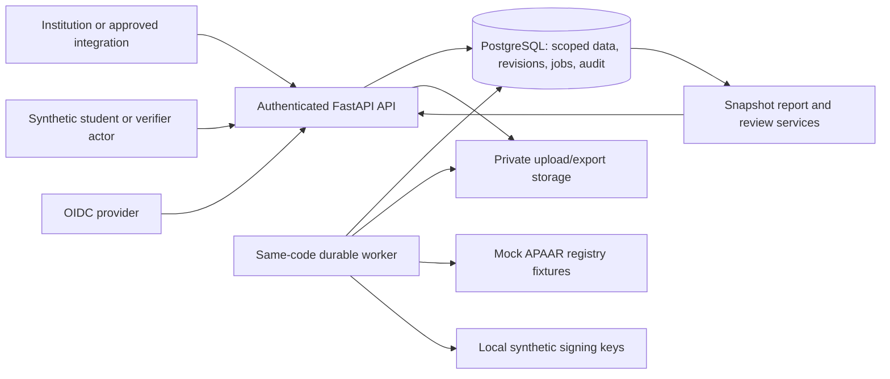

# Architecture

Extracted from the unchanged [PROJECT_SPEC.md](../PROJECT_SPEC.md), 28 October 2026. Proposed behavior, evidence limits and synthetic-only scope are preserved. Citation numbers refer to [Research and sources](RESEARCH_AND_SOURCES.md). See [documentation index](README.md) for maintenance rules.

### Deployment shape and boundaries

Choose one modular monolith and one separately restartable worker from the same source/image. PostgreSQL stores transactional state and durable jobs. Private file/object storage holds bounded original uploads and generated exports; the database stores ownership, hashes and access metadata. A standards-based identity provider supplies authentication. There is no need initially for Kafka, Redis, Kubernetes, microservices, a vector database, blockchain or an LLM decision engine. Reconsider a component when a measured bottleneck or a required capability makes it the simpler complete solution.

Modules are `access`, `institutions`, `approvals`, `identity`, `submissions`, `validation`, `review`, `attestations`, `reporting` and `audit`. A module owns its use cases and table access; avoid generic repository/service/factory layers without a real need. Shared code is limited to actual shared concerns such as transaction/context setup and typed error responses. HTTP handlers authenticate and delegate to use cases; use cases own transactions; parser/rule functions remain testable without HTTP.

The API never runs an unbounded import after sending the response. Starlette describes response background tasks as in-process. Persist a job before returning `202 Accepted`; expose its status, progress watermark and actionable failure reason. PostgreSQL documents `SKIP LOCKED` for queue-like work, making a small job table an available initial choice. This does not automatically provide retries, durability of external effects or exactly-once processing. [14](https://starlette.dev/background/) [13](https://www.postgresql.org/docs/18/sql-select.html)

The worker claims a job in a short transaction, sets an attempt/lease token, processes outside the claim lock and completes only if its token still owns the lease. Recover expired leases after crashes, cap attempts and retain failed-job evidence. Use unique effect keys for repeated processing. Add an outbox only when an external delivery is implemented; insert it with the business transaction and deliver at least once with bounded retries. Never use `SKIP LOCKED` when computing intake populations, since skipping locked admissions would make counts incorrect.
